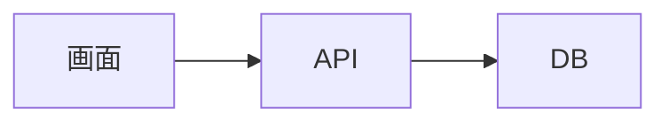

# mosunset-web 開発ドキュメント

[mosunset.com](https://mosunset.com) の開発用の仕様・設計メモを置く場所です。
セットアップやよく使うコマンドはリポジトリ直下の `README.md` を見てください。ここには「なぜそうなっているか」「これから何を作るか」を書きます。

## 見かた

```bash
pnpm docs:dev   # http://localhost:3001
```

`docs/` の Markdown を [docsify](https://docsify.js.org/) でそのまま表示しています（ビルドは要りません）。ファイルを保存するとブラウザが自動で読み直します。

## 書きかた

- 1 ページ = 1 つの Markdown ファイル。作ったら `docs/_sidebar.md` にリンクを足す
- 新しい機能の仕様は `docs/specs/` に置く（[仕様書の書き方](specs/README.md)）
- コードから読み取れることは繰り返さず、ファイルのパスを書いて案内する（例: `src/lib/collections.ts`）
- 決めたこと・決めた理由・やめたことを残す。コードと食い違ったら、どちらかを直す

## 使える書き方

コードは言語名を付けると色が付きます（`bash` `ts` `tsx` `json` `sql` `diff`）。右上のボタンでコピーできます。

図は Mermaid で書けます。

````md

````


補足や注意は docsify の書き方が使えます。

```md
?> 補足
!> 注意
```

?> 補足

!> 注意

## 設定

`docs/index.html` にまとめています。

| 項目 | 内容 |
|---|---|
| テーマ | docsify-themeable（OS の設定に合わせてライト / ダーク） |
| プラグイン | 検索・コードのコピー・前後のページ・画像の拡大・Mermaid・GitHub の編集リンク |
| サイドバー | `docs/_sidebar.md`（サブフォルダでも同じものを使う） |
| 見つからないページ | `docs/_404.md` |
| 開発用サーバー | `docsify-cli`（devDependency） |

ライブラリは CDN（jsDelivr）からバージョンを固定して読み込んでいます。上げるときは `index.html` の URL のバージョンを書き換えます。
