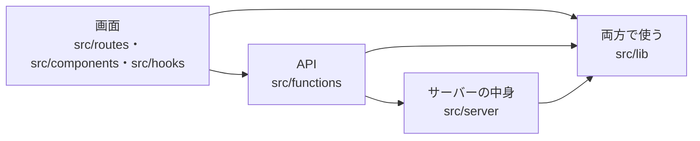
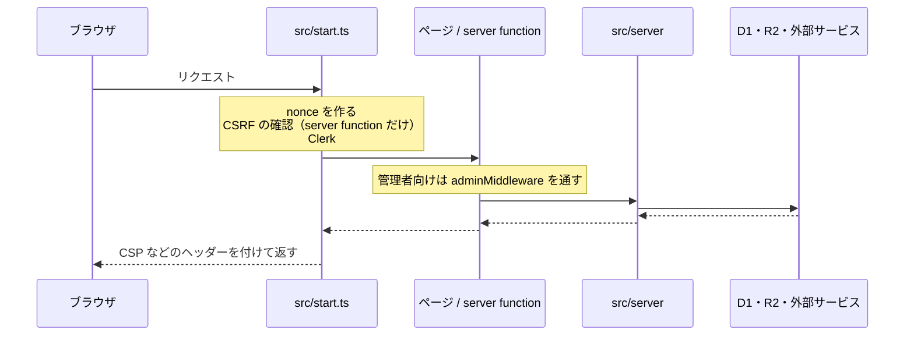

# 全体の構成

## 技術

| 役割 | 使っているもの |
|---|---|
| フレームワーク | TanStack Start（React 19・ファイルベースルーティング） |
| 見た目 | Tailwind CSS v4 ＋ shadcn/ui |
| 実行環境 | Cloudflare Workers |
| データベース | Cloudflare D1（Drizzle ORM） |
| 画像 | Cloudflare R2（`/images/*` から配信） |
| 管理画面のログイン | Clerk |
| お問い合わせ | Turnstile（ロボット対策）＋ Email Routing（通知メール） |
| 本文のエディター | Tiptap（JSON で保存） |

## 3 つの層

コードは「画面」「API」「サーバーの中身」の 3 つに分け、import できる向きを決めています。

| 層 | 置き場所 | import してよいもの |
|---|---|---|
| 画面 | `src/routes`・`src/components`・`src/hooks` | `src/functions`・`src/lib` |
| API | `src/functions`（`createServerFn` と `adminMiddleware`） | `src/server`・`src/lib` |
| サーバーの中身 | `src/server`（DB・R2・メール・Turnstile・秘密の値） | `src/lib` |

- `src/lib` は `src/server` も `src/functions` も import しない（型だけでも）。両方で使う型や定数は `src/lib` に置く（例: コレクションの種類は `src/lib/collection-kinds.ts`）
- 画面のファイルから `src/server` を import すると、`pnpm build` が import protection のエラーで止まる（`vite.config.ts` の `importProtection`）。server function の handler や `.server()` の中でだけ使うものは、ブラウザ用のバンドルでは消えるので通る
- 例外は画面を持たない server route（`sitemap.xml`・`rss.xml`・`llms.txt`・`/images/$`）と `src/start.ts`。どちらも `server.handlers` や `.server()` の中から `src/server` の関数を呼ぶだけにする

## リクエストの流れ

## ページ

| パス | 内容 | ファイル |
|---|---|---|
| `/` | トップ | `src/routes/index.tsx` |
| `/blog` | ブログ | `src/routes/blog/` |
| `/instruments` `/certifications` `/toys` `/books` | コレクション | `src/routes/<種類>/`（共通の中身は `src/lib/collection-routes.tsx`） |
| `/playground` | ブラウザで動く小さなツール | `src/routes/playground/` |
| `/contact` | お問い合わせ | `src/routes/contact.tsx` |
| `/admin` | 管理画面（記事・コレクション・お問い合わせ） | `src/routes/admin/` |
| `/sign-in` | 管理画面のログイン（Clerk） | `src/routes/sign-in.$.tsx` |
| `/images/*` | R2 の画像の配信 | `src/routes/images/$.ts` → `src/server/r2.ts` |
| `/rss.xml` `/sitemap.xml` `/llms.txt` | フィード | `src/routes/*[.]*.ts` → `src/server/feeds.ts` |
| `/robots.txt` `/.well-known/security.txt` | 機械向けのファイル | `src/routes/` |

## server function（`src/functions`）

🔒 は `adminMiddleware` 付き（管理者だけが呼べる）。

| ファイル | 公開側 | 管理画面 🔒 |
|---|---|---|
| `posts.ts` | `listPublishedPosts` `getPublishedPost` | `listPostsForAdmin` `getPostForAdmin` `savePost` `deletePost` |
| `collections.ts` | `listPublishedItems` `getPublishedItem` | `listItemsForAdmin` `getItemForAdmin` `saveItem` `deleteItem` `reorderItems` |
| `contact.ts` | `getContactConfig` `submitContact` | `listMessages` `countUnreadMessages` `getMessage` `markMessageRead` `markMessageUnread` `deleteMessage` |
| `images.ts` | | `uploadImage` |
| `isbn.ts` | | `lookupIsbn` |
| `dashboard.ts` | | `getDashboard` |
| `rich-text.ts` | | `previewRichText` |
| `auth.ts` | `getAdminStatus` | （`adminMiddleware` の定義） |

- 読むだけのものは GET、状態を変えるものは POST にする
- 公開側の取得は、公開中のものだけに絞る条件（`publishedPosts` / `publishedItems`、`src/server/db/index.ts`）を必ず使う

## よくある足し方

- **コレクションの項目を足す:** `src/lib/collections.ts` に 1 行足す。管理画面の入力欄・サーバーでの入力チェック・公開ページの表示はここから作られる。DB は変えない
- **プレイグラウンドのツールを足す:** `src/lib/playground.ts` に 1 件足し、`src/routes/playground/<slug>.tsx` と `src/components/playground/tools/` にファイルを作る。重いライブラリを使うツールは `clientOnlyTool` でブラウザでだけ読み込む（Worker に入れない）
- **外部のサービスを使う:** `src/server/security-headers.ts` の CSP に通信先を足す
