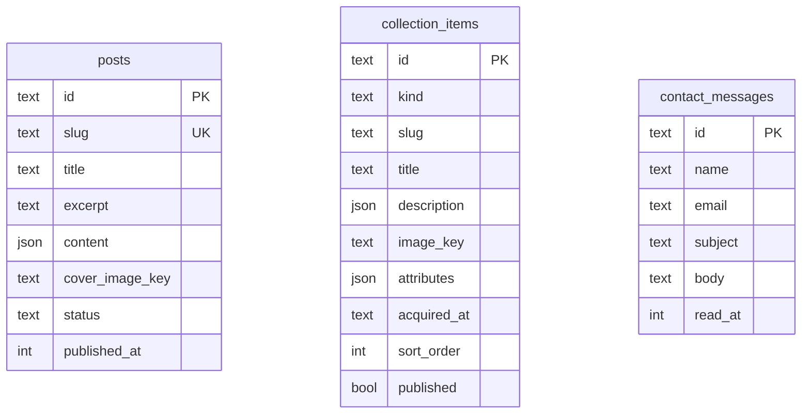

# データモデル

定義は `src/server/db/schema.ts`、マイグレーションは `drizzle/` にあります。

```bash
pnpm db:generate       # schema.ts を変えたあと、マイグレーションを作る
pnpm db:migrate:local  # 開発用の D1 に当てる
pnpm db:migrate:remote # 本番の D1 に当てる（デプロイの前に）
```

- `id` はすべて UUID、`created_at` / `updated_at` はミリ秒の UNIX 時間
- 本文（`content` / `description`）は Tiptap の JSON。保存前と表示前に `sanitizeDoc`（`src/server/rich-text.ts`）を通す
- 画像は R2 のキーだけを持ち、URL は `src/lib/images.ts` で作る
- `schema.ts` は drizzle-kit からも読まれるので、値の import は `@/` ではなく相対パスにする



## posts（ブログ記事）

| 列 | 型 | 内容 |
|---|---|---|
| `slug` | text | URL に使う。重複不可 |
| `title` / `excerpt` | text | タイトル・概要 |
| `content` | json | 本文 |
| `cover_image_key` | text | 表紙の R2 のキー |
| `status` | `draft` \| `published` | 公開状態。公開側は `publishedPosts` で絞る |
| `published_at` | timestamp | 公開日時 |

インデックス: `(status, published_at)`

## collection_items（楽器・資格・おもちゃ・本）

| 列 | 型 | 内容 |
|---|---|---|
| `kind` | `instrument` \| `certification` \| `toy` \| `book` | 種類（`src/lib/collection-kinds.ts`） |
| `slug` | text | 種類の中で重複不可 |
| `description` | json | 説明 |
| `image_key` | text | R2 のキー |
| `attributes` | json | 種類ごとの項目（メーカー・著者など） |
| `acquired_at` | text | 入手日・取得日 |
| `sort_order` | integer | 並び順 |
| `published` | boolean | 公開するか。公開側は `publishedItems` で絞る |

インデックス: `(kind, sort_order)`、一意: `(kind, slug)`

種類ごとの項目（`attributes` の中身）は `src/lib/collections.ts` で決めています。項目を足すときは DB を変えず、ここに足します。

## contact_messages（お問い合わせ）

| 列 | 型 | 内容 |
|---|---|---|
| `name` / `email` / `subject` / `body` | text | 送られてきた内容 |
| `read_at` | timestamp | 既読にした日時（`markMessageRead`、POST・管理者のみ） |
