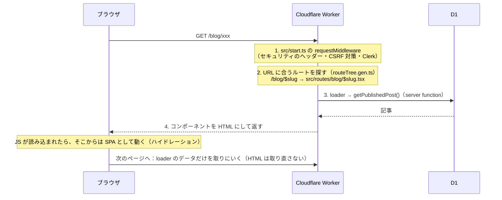

# TanStack Start 入門 第 1 回：しくみと 4 つの道具

このサイトのコードを教材にして、TanStack Start の基本を順に学ぶための資料です。第 1 回では、全体の流れと、いちばんよく使う 4 つの道具（ルート・loader・server function・middleware）を扱います。

## そもそも何をするものか

TanStack Start は次の 2 つを組み合わせたものです。

- **TanStack Router**：URL とページの対応を決める
- **サーバーで動く部分**：ページを先にサーバーで HTML にする（SSR）。ブラウザからサーバーの関数を呼ぶこともできる

このサイトでは、それが Cloudflare Workers の上で動いています（`vite.config.ts` の `cloudflare()` と `tanstackStart()`）。

## ページが表示されるまで（/blog/xxx を開いたとき）



## 道具 1：ファイルがそのまま URL になる（ルート）

`src/routes/` の中のファイルの置き方が、そのまま URL になります。

| ファイル | URL | 役目 |
|---|---|---|
| `__root.tsx` | 全ページ | 共通の `<head>`・外枠 |
| `blog/route.tsx` | `/blog` 以下すべて | 親（レイアウト）。`<Outlet />` の場所に子が入る |
| `blog/index.tsx` | `/blog` | 一覧 |
| `blog/$slug.tsx` | `/blog/何か` | `$` が付いている部分は変数になり、`params.slug` で読める |
| `robots[.]txt.ts` | `/robots.txt` | `[.]` は「ここは本当の点」という意味 |

`src/routeTree.gen.ts` はこの置き方から**自動で作られる**ファイルなので、手で書き換えません。

## 道具 2：loader（ページを出す前にデータを取る）

`src/routes/blog/$slug.tsx`

```ts
export const Route = createFileRoute('/blog/$slug')({
  loader: ({ params }) => getPublishedPost({ data: { slug: params.slug } }),
  head: ({ loaderData }) => ({ meta: seo({ title: loaderData.title, ... }) }),
  component: ...,   // 中では Route.useLoaderData() で受け取る
})
```

- loader は、ページを表示する**前**に実行されます。最初に開いたときはサーバーで、リンクで移ったときはブラウザから実行されます。
- `head` は loader の結果を使って、ページの `<title>` などを作ります（SEO 用）。
- `src/router.tsx` に `defaultPreload: 'intent'` と書いてあるので、リンクにマウスを乗せた時点で loader が先に走ります。押す前から取りにいくので、ページが速く出ます。

## 道具 3：server function（ブラウザから呼べるサーバーの関数）

`src/functions/posts.ts`

```ts
export const getPublishedPost = createServerFn({ method: 'GET' })
  .validator((data: unknown) => z.object({ slug: z.string() }).parse(data))
  .handler(async ({ data }) => {
    const post = await getDb().query.posts.findFirst(...)   // D1 を直接読む
    if (!post) throw notFound()
    ...
  })
```

ここがいちばん大事なところです。

- 書いているのはふつうの関数ですが、**ブラウザ用にビルドするときには、中身が「サーバーに fetch する処理」に置き換わります**。そのため、DB や R2、秘密の値を使うコードはブラウザに届きません。
- `.validator()` で受け取る値を確かめます。ブラウザから来る値は信用できないので、zod で形を確かめます。
- `getDb()`（`src/server/db/index.ts`）が `cloudflare:workers` の `env.DB` を使えるのは、サーバー（Worker）の中で動くからです。

このサイトでは念のため、`vite.config.ts` の `importProtection` で、`src/server/` の中身をブラウザ側から import したらビルドが失敗するようにしてあります（[全体の構成](architecture.md) の「3 つの層」）。

## 道具 4：middleware（前後に処理を挟む）

種類が 2 つあります。

- **request middleware**（`src/start.ts`）：すべてのリクエストに挟まります。このサイトでは、ヘッダーを付ける処理・CSRF 対策・Clerk のログイン確認です。
- **function middleware**（`src/functions/auth.ts` の `adminMiddleware`）：付けた server function にだけ挟まります。

```ts
export const saveItem = createServerFn({ method: 'POST' })
  .middleware([adminMiddleware])   // 管理者でなければここで止まる
  .validator(...)
  .handler(...)
```

`/admin` の `beforeLoad`（`src/routes/admin/route.tsx`）でも管理者かどうかを確かめていますが、それは画面を出すかどうかの判断にすぎません。**データを守るのは server function 側の middleware** です。server function はブラウザから直接呼べてしまうので、画面のチェックだけでは守れません。

## おまけ：server route（HTML 以外を返す）

`src/routes/robots[.]txt.ts` は `component` の代わりに `server.handlers.GET` を持っていて、ふつうの `Response` を返します。RSS・sitemap・画像の配信も同じ形です。

## 続き

- [第 2 回：データの流れ（読む・書く・読み直す）](learn/tanstack-start-2.md)
- [第 3 回：ルートの細かい機能](learn/tanstack-start-3.md)
- [第 4 回：SSR まわり](learn/tanstack-start-4.md)
- [第 5 回：Cloudflare との組み合わせ](learn/tanstack-start-5.md)
