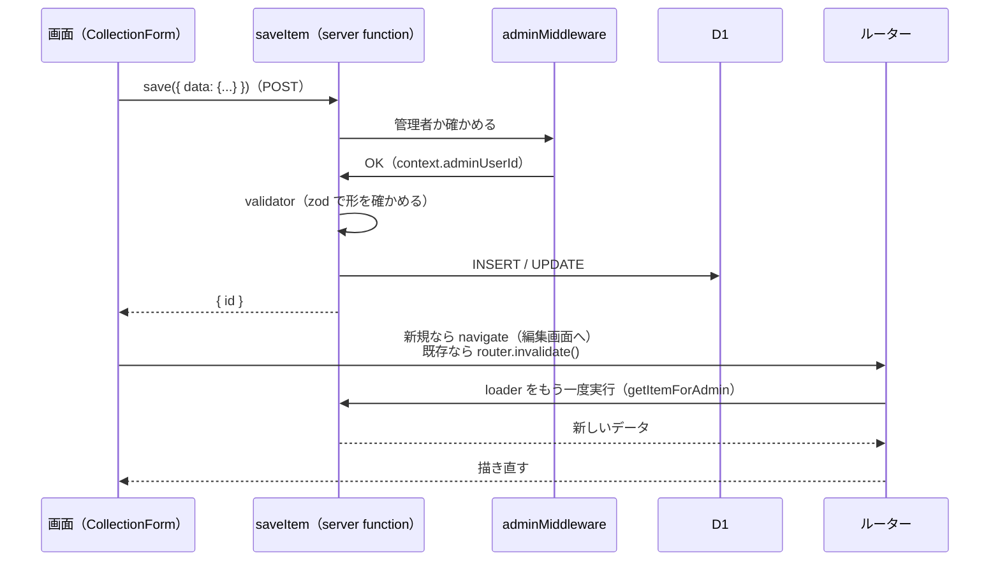

# TanStack Start 入門 第 2 回：データの流れ（読む・書く・読み直す）

第 1 回では、ページを開いたときに loader がデータを取るところまでを見ました。第 2 回では、その続きとして「画面から保存する → 画面を新しくする」流れを、管理画面のコレクションの編集（`src/components/admin/collection-form.tsx`）で追います。

## 全体の流れ



## 読む：loader と server function

読むときは、第 1 回と同じく loader から server function を呼びます。

`src/routes/admin/collections/$kind/$id.tsx`

```ts
export const Route = createFileRoute('/admin/collections/$kind/$id')({
  loader: async ({ params }) => {
    const item = await getItemForAdmin({ data: { id: params.id } })
    if (item.kind !== params.kind) throw notFound()
    return item
  },
  component: EditItem,
})

function EditItem() {
  const { kind } = Route.useParams()
  const item = Route.useLoaderData()   // loader が返したもの。型も自動でつく
  ...
}
```

`Route.useLoaderData()` の型は、loader の戻り値から自動で決まります。さらに loader の戻り値は server function の戻り値なので、**D1 から取った行の型が、そのまま画面のコンポーネントまで届きます**。API の型を別に書かなくてよいのが、TanStack Start のいちばんの便利なところです。

コンポーネントの props に型を書くときも、server function から型を取り出せます（`collection-form.tsx`）。

```ts
item?: Awaited<ReturnType<typeof getItemForAdmin>>
```

## 書く：useServerFn

画面のボタンから server function を呼ぶときは、`useServerFn` で包みます。

```ts
const save = useServerFn(saveItem)
const remove = useServerFn(deleteItem)
...
await save({ data: { id: item?.id, kind, ...fields } })
```

server function はそのまま呼んでも動きます。`useServerFn` で包むと、**server function の中で投げた `redirect()` を、ルーターが受け取ってその URL へ移ってくれる**ようになります（`node_modules/@tanstack/react-start/dist/esm/useServerFn.js` を見ると、やっていることはこれだけです）。ふつうに呼ぶと、`redirect()` はただの例外として返ってくるだけです。`notFound()` やふつうのエラーは、包んでも包まなくても例外として返ってきます。画面から呼ぶときは包む、と覚えておけば十分です。

引数は必ず `{ data: ... }` の形で渡します。`data` に入れたものが、サーバー側の `.validator()` に渡ります。

## サーバー側：middleware → validator → handler の順

`src/functions/collections.ts`

```ts
export const saveItem = createServerFn({ method: 'POST' })
  .middleware([adminMiddleware])
  .validator((data: unknown) => itemInputSchema.parse(data))
  .handler(async ({ data }) => {
    const db = getDb()
    const id = data.id ?? crypto.randomUUID()
    ...
  })
```

- `method` は、読むだけなら `GET`、書き換えるなら `POST` にします。`GET` はブラウザやリンクの先読みで何度も呼ばれることがあるので、書き換える処理には使いません。
- `.middleware()` → `.validator()` → `.handler()` の順に実行されます。middleware で止まれば validator も handler も動きません。
- `.validator()` が返した値が `handler` の `data` になります。zod の `parse` を通した後なので、`data` の型は `itemInputSchema` の型になります。
- handler の中で投げたエラーは、呼んだ側（画面）の `await save(...)` で例外として受け取れます。`useEditableForm` の `runSave` が `try / catch` でそれを受けて、トーストに出しています（`src/hooks/admin/use-editable-form.ts`）。

## 読み直す：router.invalidate()

保存したあと、loader が前に取ったデータは古いままです。TanStack Router は loader の結果を覚えておく（キャッシュする）ので、自分で「古くなった」と知らせる必要があります。

```ts
onSaved: async (result) => {
  if (!item) {
    // 新しく作ったとき：編集画面へ移る（移った先の loader が新しいデータを取る）
    await router.navigate({
      to: '/admin/collections/$kind/$id',
      params: { kind, id: result.id },
      replace: true,
    })
  } else {
    // 直したとき：今のページの loader をすべてやり直す
    await router.invalidate()
  }
}
```

- `router.invalidate()` は、**今表示しているルートの loader を全部やり直して**、描き直します。親の loader（`/admin` の未読の数など）もやり直されます。
- 管理画面の一覧で並べ替えたあとや、公開・非公開を切り替えたあとも、同じように `router.invalidate()` を呼んでいます（`src/routes/admin/collections/$kind/index.tsx`）。
- `navigate` の `to` と `params` は型で確かめられます。存在しないパスを書いたり、`params` を書き忘れたりすると型エラーになります。

## なぜ TanStack Query を使っていないのか

TanStack にはデータ取得用の TanStack Query もあります。このサイトでは使わず、loader と `router.invalidate()` だけで済ませています。

- 書き換えるのは管理者 1 人だけで、同じデータを別々の場所で何度も読む画面が少ない
- ページを移るたびに loader が新しいデータを取るので、ページ単位で考えれば足りる

`router.tsx` の `defaultPreloadStaleTime: 0` は「リンクにマウスを乗せて先読みしたデータを、すぐ古いもの扱いにする」設定です。先読みの結果を Router 自身のキャッシュで長く使い回さないようにしています（TanStack Query と組み合わせるときの定番の書き方で、ここでもそのまま使っています）。

## まとめ

| やりたいこと | 使うもの | このサイトの例 |
|---|---|---|
| ページを出す前に読む | `loader` ＋ server function（GET） | `getItemForAdmin` |
| 画面から書き換える | `useServerFn` ＋ server function（POST） | `saveItem` / `deleteItem` |
| 書き換えたあと画面を新しくする | `router.invalidate()` / `router.navigate()` | `collection-form.tsx` の `onSaved` |
| 管理者だけに許す | function middleware | `adminMiddleware` |
| 受け取る値を確かめる | `.validator()` ＋ zod | `itemInputSchema` |
