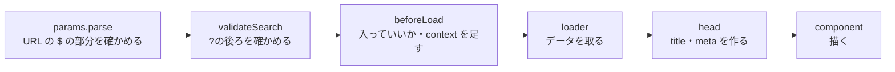

# TanStack Start 入門 第 3 回：ルートの細かい機能

`createFileRoute()` には、`loader` と `component` のほかにもたくさんの設定があります。第 3 回では、このサイトで使っているものを順に見ます。

## 1 つのルートで動く順番

ページを開くと、ルートの設定は次の順に動きます。親のルートから順に、子のルートへ進みます。



- `beforeLoad` は親から子へ**順番に**動きます。親の `beforeLoad` が返したものを子が使えるからです。
- `loader` は、すべての `beforeLoad` が終わったあと、**親も子もいっしょに（並行して）**動きます。

## beforeLoad と context：入っていいかを決める

`src/routes/admin/route.tsx`

```ts
export const Route = createFileRoute('/admin')({
  beforeLoad: async ({ location }) => {
    const admin = await getAdminStatus()
    if (admin.status === 'signed-out') {
      throw redirect({
        href: `/sign-in?redirect_url=${encodeURIComponent(location.href)}`,
      })
    }
    return { admin }          // ← context に足される
  },
  loader: async ({ context }) => ({
    unreadCount:
      context.admin.status === 'admin' ? await countUnreadMessages() : 0,
    ...
  }),
})
```

- `beforeLoad` で `redirect()` を投げると、ページを描かずに別の URL へ移ります。
- `beforeLoad` が返したオブジェクトは **context** に足されます。同じルートの `loader` や、`/admin` の下にある**すべての子ルート**から `context.admin` として読めます。コンポーネントの中では `Route.useRouteContext()` で読めます。
- `/admin` の下のページ（記事・コレクション・お問い合わせ）が、それぞれ管理者かどうかを確かめなくてよいのはこのためです。親で 1 回確かめれば、子はすべてその下に入ります。

第 1 回のとおり、これは「画面を出すかどうか」の判断です。データを守るのは server function の `adminMiddleware` です。

## redirect と notFound：投げて使う

TanStack Router では、`redirect()` と `notFound()` を **`throw` して**使います。`beforeLoad`・`loader` で投げたものはルーターが受け取ります。loader から呼んだ server function の中で投げたものも、そのまま loader から投げられたことになるので、同じように受け取られます（画面のボタンから呼んだときは第 2 回のとおりで、`redirect()` だけが `useServerFn` で処理されます）。

```ts
// src/functions/posts.ts（server function の中）
if (!post) throw notFound()
```

```ts
// src/routes/admin/collections/$kind/$id.tsx（loader の中）
if (item.kind !== params.kind) throw notFound()
```

`notFound()` を投げると、そのルートの `notFoundComponent` が出ます。ルートに書いていなければ、親のものが使われます。このサイトでは `__root.tsx` の `notFoundComponent: NotFound` が最後の受け皿です。どのルートにも合わない URL のときも、これが出ます。

## params.parse：URL の $ の部分を確かめる

`src/routes/admin/collections/$kind/route.tsx`

```ts
export const Route = createFileRoute('/admin/collections/$kind')({
  params: {
    parse: ({ kind }) => {
      if (!isCollectionKind(kind)) throw notFound()
      return { kind }        // ← ここから先、kind の型は CollectionKind になる
    },
    stringify: ({ kind }) => ({ kind }),
  },
})
```

`$kind` には URL のどんな文字でも入るので、ふつうは `string` 型です。`params.parse` で確かめて返すと、子ルートの `Route.useParams()` でも `kind` が `'toy' | 'book' | ...` 型になります。`/admin/collections/abc` のような知らない種類は、ここで 404 になります。

## validateSearch：URL の ? の後ろを型にする

一覧の検索・並べ替え・表示のしかたは、URL の `?q=…&sort=…&view=…` に入れています。こうしておくと、リロードしても、URL を人に送っても同じ表示になります。

`src/routes/blog/index.tsx`

```ts
export const Route = createFileRoute('/blog/')({
  validateSearch: listSearchValidator(),
  ...
})
// コンポーネントの中
const search = Route.useSearch()   // { q?: string; sort?: string; view?: ViewMode }
```

- `validateSearch` は、URL の値（何が入っているかわからない）を受け取って、決まった形のオブジェクトを返す関数です。知らないキーや変な値はここで捨てます（`src/components/list/list-search.ts`）。
- TanStack Router は `?` の後ろを JSON として読もうとするので、`?q=2026` は**数の 2026** として届きます。そのため `listSearchValidator` では、数を文字に戻しています。`/admin/collections/$kind/new` の `?isbn=` も同じです。
- 値を変えるときは、`navigate({ to: '.', search: (prev) => ({ ...prev, sort: 'title' }) })` のように、今の URL のまま `?` の後ろだけを変えます（`src/components/list/use-list.ts`）。

`new.tsx` のコメントにあるとおり、**ルートの設定（`createFileRoute` に渡すもの）はどのページを開いても読み込まれます**。そこに zod のような大きいものを import すると、全ページの JS が重くなります。そのため、ここでは zod を使わずに手で確かめています。

## staticData：ルートに自分の印を付ける

`staticData` は、TanStack Router 自身は使わない「自由に置ける欄」です。このサイトではパンくずと、管理者向けの「編集」ボタンの行き先に使っています。

```ts
// src/routes/blog/$slug.tsx
staticData: {
  breadcrumb: (match) => match.loaderData?.title,
  editHref: (match) =>
    match.loaderData?.editId ? `/admin/posts/${match.loaderData.editId}` : undefined,
},
```

- 型は `src/lib/breadcrumbs.ts` の `declare module '@tanstack/react-router'` で足しています。こうすると、どのルートで `staticData` に書いても型が効きます。
- `resolveBreadcrumbs(matches)` は、今合っているルート（親から子まで全部）の `staticData.breadcrumb` を集めて、パンくずを作ります。`__root.tsx` の `head` では、同じものを構造化データ（BreadcrumbList）にもしています。

## head：ページごとの title と meta

`head` は loader の結果を使えます。親と子の両方に `head` があると、**同じ名前の meta は子のほうが勝ちます**。

- `__root.tsx` の `head`：サイト共通のもの（文字コード・OG 画像・RSS・canonical など）
- 各ページの `head`：そのページの title と description

`__root.tsx` のコメントのとおり、`link`（canonical など）は親と子で重複を消してくれないので、root でだけ出しています。

## 一覧と詳しいページの設定をまとめる

楽器・資格・おもちゃ・本の 4 種類は、一覧と詳しいページの作りが同じです。`src/components/collection/collection-routes.tsx` の関数で設定を作り、各ファイルで広げて使っています。

```ts
// src/routes/toys/index.tsx
export const Route = createFileRoute('/toys/')({
  ...collectionIndexOptions('toy'),
  component: () => <CollectionIndexPage kind="toy" />,
})
```

`createFileRoute('/toys/')` だけは各ファイルにそのまま書く必要があります。ルートの木（`routeTree.gen.ts`）を作るプログラムが、ファイルの中のこの部分を読むためです。

## まとめ

| 設定 | 役目 | このサイトの例 |
|---|---|---|
| `params.parse` | `$` の部分を確かめて型を付ける | `/admin/collections/$kind` |
| `validateSearch` | `?` の後ろを確かめて型を付ける | 一覧の `q`・`sort`・`view` |
| `beforeLoad` | 入っていいか・`context` を足す | `/admin` |
| `loader` | データを取る | ほぼ全ページ |
| `head` | title・meta | `sectionHead`・`seo` |
| `staticData` | 自分で決めた印 | パンくず・編集ボタン |
| `notFoundComponent` | 404 の表示 | `__root.tsx` |
