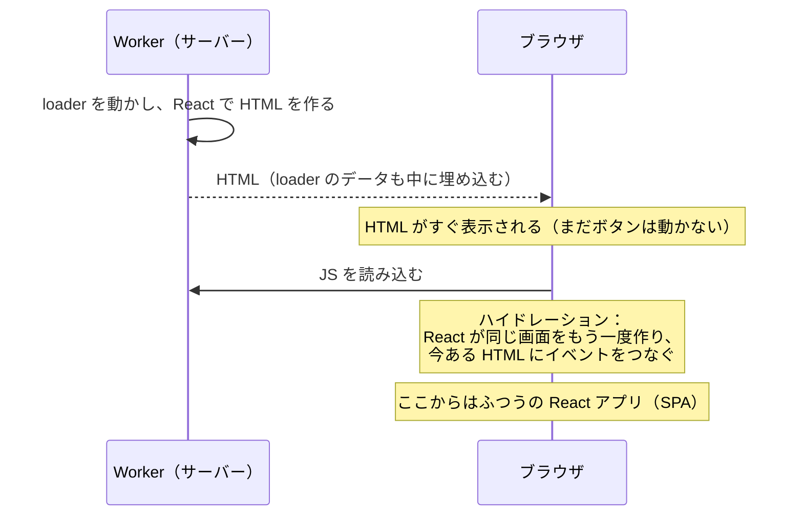
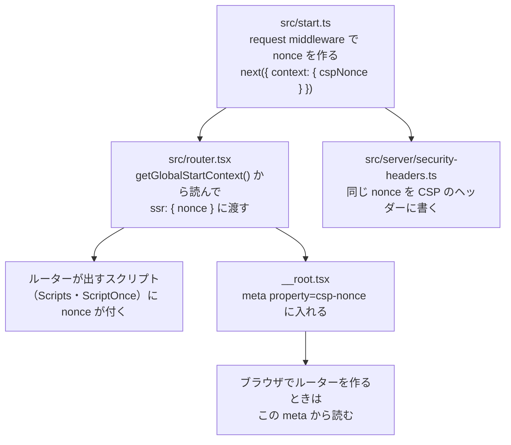

# TanStack Start 入門 第 4 回：SSR まわり

第 4 回では、「サーバーで HTML を作り、ブラウザでそれを引き継ぐ」ところで起きることを見ます。ここをわかっておくと、「表示が一瞬ちらつく」「サーバーとブラウザで結果が違う」といった問題の原因がわかるようになります。

## SSR とハイドレーション



- サーバーで作った HTML の中には、loader の結果も埋め込まれています。そのため、ブラウザは loader をもう一度呼ばずに、同じデータで画面を作り直せます。
- ハイドレーションでは、**サーバーで作った HTML と、ブラウザで作った画面が同じでなければなりません**。違うと React が警告を出し、場合によってはサーバーの表示を捨てて作り直します（画面がずれる・ちらつく）。

## ずれの原因になるもの

サーバーとブラウザで違う値になるものは、ずれの原因になります。

- `localStorage`・`window`・`document`（サーバーには無い）
- 今の時刻・乱数
- 端末の設定（ダークモードかどうか、画面の幅）

このサイトのテーマ（ライト・ダーク）がまさにこれです。選んだテーマは `localStorage` にあるので、サーバーは知りません。

## ScriptOnce：描く前に 1 回だけ動かす

`src/routes/__root.tsx`

```tsx
<html lang="ja" suppressHydrationWarning>
  <head>
    <HeadContent />
    <ScriptOnce>{themeInitScript}</ScriptOnce>
  </head>
```

- `themeInitScript`（`src/lib/theme.ts`）は、`localStorage` を読んで `<html>` に `dark` クラスを付けるだけの小さなスクリプトです。
- `ScriptOnce` は、それを `<head>` の中にそのまま書き出します。ブラウザは画面を描く**前**にこれを動かすので、ダークの人に白い画面が一瞬出ることがありません。
- `ScriptOnce` という名前のとおり、ページを移るたびに動き直すことはありません。最初の 1 回だけです。
- スクリプトが `<html>` の class を書き換えるので、サーバーの HTML とずれます。`suppressHydrationWarning` は「この要素の属性のずれは気にしない」という印です。

## createIsomorphicFn：サーバーとブラウザで中身を変える

loader は、最初はサーバーで、そのあとはブラウザで動きます。同じことをするのに、サーバーとブラウザでやり方が違うものがあります。cookie の読み方がその例です。

`src/lib/admin-sidebar.ts`

```ts
export const readAdminSidebarOpen = createIsomorphicFn()
  .server(() => getCookie(adminSidebarCookie.name) !== 'false')
  .client(() => !document.cookie.split('; ').includes(`${adminSidebarCookie.name}=false`))
```

- サーバーではリクエストの cookie を読み、ブラウザでは `document.cookie` を読みます。
- ビルドのときに、サーバー用には `.server()` の中身だけ、ブラウザ用には `.client()` の中身だけが残ります。
- 管理画面の左メニューを閉じているかどうかを cookie に入れているのは、**サーバーで HTML を作る時点で知っておくため**です。`localStorage` だとサーバーは知らないので、開いた状態で描いてからブラウザで閉じることになり、表示がずれます。

`readSignedInHint`（`src/lib/auth/clerk-hint.ts`、ログインしているらしいかどうか）も同じ作りです。

server function との違いは次のとおりです。

| | server function | createIsomorphicFn |
|---|---|---|
| ブラウザで呼んだとき | サーバーに通信して、サーバーで動く | ブラウザでそのまま `.client()` が動く |
| 使いどころ | DB・秘密の値など、サーバーにしか無いもの | 両方にあるが、読み方が違うもの |

## src/client.tsx：ブラウザ側の入口

ふつうは書かなくてもよいファイルですが、このサイトでは置いています。

```ts
const path = window.location.pathname
Promise.all([
  preloadToolForPath(path),
  isClerkPath(path) || readSignedInHint() ? preloadClerk() : undefined,
]).then(hydrate)
```

プレイグラウンドのツールや Clerk の部品は、あとから読み込む（遅延読み込みの）JS です。ハイドレーションの時点でまだ読み込めていないと、React はサーバーの HTML を捨てて「読み込み中」を出し直してしまいます。そのため、**先に読み込んでからハイドレーションを始める**ようにしています。

## CSP の nonce：サーバーとブラウザで同じ値を使う

このサイトは CSP（Content-Security-Policy）で、「サーバーが許したスクリプトだけ動かせる」ようにしています。許したスクリプトには、リクエストごとに作る使い捨ての値（nonce）を付けます。



- request middleware の `next({ context: { ... } })` で渡したものは、そのリクエストのあいだ、`getGlobalStartContext()` で読めます。
- `getRouter()` はサーバーでもブラウザでも呼ばれます。サーバーでは context から、ブラウザでは `<meta>` から nonce を読みます（`typeof document === 'undefined'` で見分けています）。

## shellComponent：外枠だけを描く

`__root.tsx` は `component` ではなく `shellComponent: RootDocument` を使っています。`shellComponent` は `<html>`・`<head>`・`<body>` の外枠で、**エラーや 404 のときでも必ず描かれます**。`<HeadContent />`（head の中身）と `<Scripts />`（ブラウザで動かす JS）は、ここに置く決まりです。

## まとめ

| 困りごと | 対策 | このサイトの例 |
|---|---|---|
| ブラウザにしか無い値で、表示が一瞬ずれる | 描く前に動くスクリプト | `ScriptOnce` ＋ `themeInitScript` |
| サーバーでも知っておきたい | cookie に入れる | 管理画面の左メニュー |
| サーバーとブラウザで読み方が違う | `createIsomorphicFn` | `readAdminSidebarOpen` |
| 遅れて読む部品で、ハイドレーションがずれる | 先に読んでからハイドレーション | `src/client.tsx` |
| リクエストごとの値をルーターに渡す | request middleware の context | CSP の nonce |
