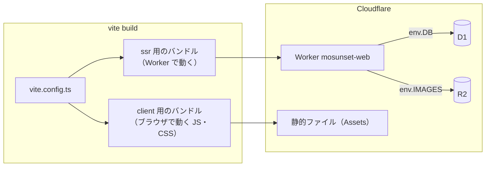
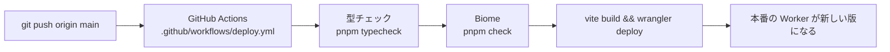

# TanStack Start 入門 第 5 回：Cloudflare との組み合わせ

最後の回では、TanStack Start が Cloudflare Workers の上でどう動いているか、ビルドからデプロイまでを見ます。

## 全体のつながり



- Vite は 1 回のビルドで、**ブラウザ用（client）とサーバー用（ssr）の 2 つ**を作ります。第 1 回で見た「server function の中身がブラウザ用では fetch に置き換わる」のは、この 2 つを作り分けるときです。
- `vite.config.ts` の `cloudflare({ viteEnvironment: { name: 'ssr' } })` が、「ssr 用のほうを Cloudflare の Worker として作る」という指定です。
- ブラウザ用の JS・CSS・画像は Worker を通らず、Cloudflare が静的ファイルとしてそのまま返します。

## Worker の入口

`wrangler.jsonc`

```jsonc
"main": "@tanstack/react-start/server-entry",
```

Worker の入口は、TanStack Start が用意したもの（`server-entry`）です。自分で `fetch(request, env)` を書く必要はありません。届いたリクエストはここから、第 1 回で見た流れ（request middleware → ルート → loader → HTML）に入ります。

開発中（`pnpm dev`）も、Cloudflare の Vite プラグインが本物の Workers と同じしくみ（workerd）でサーバー側を動かします。そのため、`cloudflare:workers` の import や D1・R2 が、開発中でもそのまま使えます。

## env：D1・R2 などを使う

`wrangler.jsonc` の「バインディング」に書いたものは、サーバーのコードから `env` として使えます。

| `wrangler.jsonc` | 名前 | 使っている場所 |
|---|---|---|
| `d1_databases` | `env.DB` | `src/server/db/index.ts` の `getDb()` |
| `r2_buckets` | `env.IMAGES` | `src/server/r2.ts` |
| `send_email` | `env.EMAIL` | お問い合わせの通知（`src/server/notify.ts`） |
| `vars` | `CLERK_PUBLISHABLE_KEY` など | 公開してよい設定の値 |
| `wrangler secret put` | `CLERK_SECRET_KEY` など | 秘密の値（ファイルには書かない） |

```ts
// src/server/db/index.ts
import { env } from 'cloudflare:workers'

export function getDb() {
  return drizzle(env.DB, { schema })
}
```

- `cloudflare:workers` は Worker の中にしか無いので、**`src/server/` の中だけで import します**。ブラウザ用のバンドルに入るとビルドが失敗するように、`vite.config.ts` の `importProtection` で守っています。
- `vars` と secret の値は、`env.名前` のほか `process.env.名前` でも読めます（`compatibility_flags` の `nodejs_compat` のおかげ）。このサイトでは `src/server/notify.ts` の Clerk の呼び出しなどで、秘密の値を読んでいます。
- 開発中は `.dev.vars` に書いた値が使われます（テスト用のキーなど）。
- バインディングを変えたら `pnpm cf-typegen` で `env` の型を作り直します。

## server route で Response を返す

R2 の画像は、server route がそのまま返しています。

`src/routes/images/$.ts`

```ts
export const Route = createFileRoute('/images/$')({
  server: {
    handlers: {
      GET: ({ params }) => imageResponse(params._splat ?? ''),
    },
  },
})
```

- ファイル名の `$` だけのものは「この下の残り全部」という意味です。`/images/posts/abc.webp` なら `params._splat` が `posts/abc.webp` になります。
- `imageResponse`（`src/server/r2.ts`）は `env.IMAGES.get()` で R2 から取り出し、Web 標準の `Response` で返します。`cache-control` を付けて、Cloudflare とブラウザに長く覚えておいてもらいます。
- `handlers` には `GET` のほか `POST` なども書けます。ページを描かない URL（API・RSS・sitemap・画像）は、この形で書きます。

## ビルドで気をつけていること

`vite.config.ts` に、このサイトならではの設定がいくつかあります。

- **`importProtection`**：`src/server/` と `*.server.*` を、ブラウザ用から import したらビルドを失敗させる（秘密の値や DB のコードがブラウザに届かないように）
- **`codeSplitting.groups`**：ページを開いたときに必ず読む JS を 1 つのファイルにまとめる（細かく分かれていると、Lighthouse が遅く見積もるため）
- **`optimizeDeps.include`**：開発中に、Clerk や Tiptap が途中で最適化し直されて壊れるのを防ぐ

## デプロイ



- `wrangler deploy` は、ビルドしたサーバー用のコードを Worker として、ブラウザ用のファイルを静的ファイルとして、まとめて Cloudflare に上げます。
- D1 のマイグレーション（表の形の変更）は Actions では流しません。必要なときは push の前に、手元で `pnpm db:migrate:remote` を流します。push からデプロイが終わるまでのあいだも古いコードが動いているので、**古いコードのままでも動く変更（列を足すなど）**にしておきます。
- 詳しい手順は [デプロイ](deploy.md) にあります。

## 5 回のまとめ

| 回 | 内容 | 中心のファイル |
|---|---|---|
| 1 | しくみと 4 つの道具（ルート・loader・server function・middleware） | `src/routes/blog/$slug.tsx`・`src/functions/posts.ts`・`src/start.ts` |
| 2 | データの流れ（読む・書く・読み直す） | `src/components/admin/collection-form.tsx` |
| 3 | ルートの細かい機能（beforeLoad・params・search・staticData） | `src/routes/admin/route.tsx`・`src/components/list/list-search.ts` |
| 4 | SSR まわり（ハイドレーション・ScriptOnce・nonce） | `src/routes/__root.tsx`・`src/router.tsx` |
| 5 | Cloudflare との組み合わせ（env・server route・デプロイ） | `wrangler.jsonc`・`vite.config.ts` |
